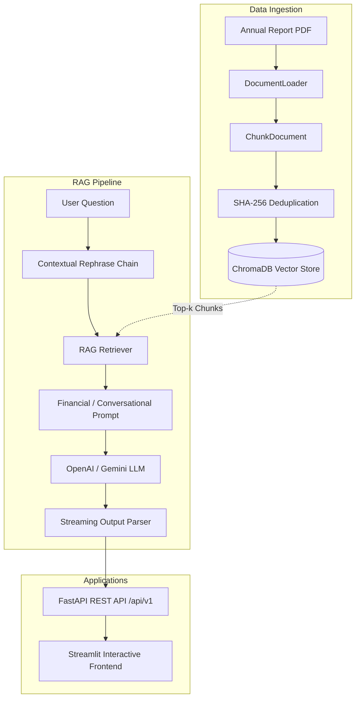

# 📈 AI-Powered Financial Stock Analysis

[](https://www.python.org/)
[](https://fastapi.tiangolo.com)
[](https://streamlit.io)
[](https://www.langchain.com/)
[](https://www.trychroma.com/)
[](LICENSE)

An enterprise-grade **Retrieval-Augmented Generation (RAG)** system built to analyze corporate annual reports (SEC 10-K, 10-Q) with deep financial intelligence. The system automates structured financial report generation and provides an interactive conversational assistant with real-time streaming and source attribution.

---

## 🌟 Key Features

- **📑 Automated Financial Analysis Report**: Generates structured, professional investment reports covering Consolidated Statements of Operations, revenue segments, operating risks, and valuation drivers.
- **💬 Conversational RAG with Contextual Rephrasing**: Multi-turn dialogue with memory that reformulates follow-up queries based on conversational history.
- **⚡ Real-Time Streaming Responses**: Low-latency token streaming using Server-Sent Events (`text/event-stream`) in FastAPI and `st.write_stream` in Streamlit.
- **📥 Smart PDF Ingestion & Deduplication**: Upload corporate 10-K PDFs with deterministic SHA-256 chunk hashing to eliminate redundant embeddings.
- **🎯 Document-Filtered Retrieval**: Switch between cross-company search or ground retrieval strictly to a selected filing (e.g., `NASDAQ_AAPL_2025.pdf`).
- **🧩 Decoupled Modular Architecture**: Clean separation between ingestion, retrieval, prompt pipelines, FastAPI REST backend, and Streamlit frontend.

---

## 🏗️ Architecture



---

## 📂 Project Structure

```text
AI-powered-stock-analysis/
├── data/                         # Uploaded company annual reports (.pdf)
├── storage/                      # Persistent ChromaDB vector store
├── logs/                         # Structured application logs
├── src/
│   ├── backend/
│   │   ├── api/
│   │   │   ├── __init__.py
│   │   │   ├── route.py          # FastAPI endpoints (/health, /upload, /report, /chat, /companies)
│   │   │   └── schema.py         # Pydantic request & response schemas
│   │   ├── generation/
│   │   │   ├── llm.py            # Multi-provider LLM Factory (OpenAI, Gemini)
│   │   │   └── prompt.py         # Financial report & conversational prompt templates
│   │   ├── indexing/
│   │   │   ├── document_loader.py# PyPDFLoader with format validation
│   │   │   ├── document_split.py # Recursive text chunker
│   │   │   └── vector_store.py   # ChromaDB manager with SHA-256 deduplication
│   │   ├── pipeline/
│   │   │   └── rag_pipeline.py   # End-to-end Financial RAG pipeline orchestrator
│   │   ├── retriever/
│   │   │   └── retriever.py      # Filtered similarity retriever
│   │   └── utils/
│   │       ├── CommonInterface.py# Component base interface
│   │       └── logger.py         # Standardized logging utility
│   └── frontend/
│       └── app.py                # Streamlit user interface
├── .env.example                  # Environment variable template
├── pyproject.toml                # Project metadata & dependencies
├── requirement.txt               # Pinned package requirements
└── README.md
```

---

## 🚀 Getting Started

### Prerequisites
- Python `3.12` or higher
- [uv](https://docs.astral.sh/uv/) (recommended ultra-fast package manager) or `pip`

### 1. Clone the Repository
```bash
git clone https://github.com/Himansh19-lab/AI-powered-stock-analysis.git
cd AI-powered-stock-analysis
```

### 2. Environment Configuration
Copy the example environment file and add your API keys:
```bash
cp .env.example .env
```
Edit `.env`:
```env
OPENAI_API_KEY="your-openai-api-key"
GOOGLE_API_KEY="your-google-api-key"
HF_TOKEN="your-huggingface-token"
```

### 3. Install Dependencies
Using `uv`:
```bash
uv sync
```
*Or using traditional `pip`:*
```bash
python -m venv .venv
source .venv/bin/activate  # On Windows: .venv\Scripts\activate
pip install -r requirement.txt
```

---

## 🖥️ Running the Application

### 1. Start the FastAPI Backend
```bash
uv run uvicorn --app-dir src backend.api.route:app --reload --port 8000
```
- API will be live at: `http://localhost:8000`
- Interactive Swagger API docs: `http://localhost:8000/docs`

### 2. Start the Streamlit Frontend
In a separate terminal window:
```bash
uv run streamlit run src/frontend/app.py
```
- Web UI will automatically open at: `http://localhost:8501`

---

## 📡 API Reference

| Method | Endpoint | Description |
| :--- | :--- | :--- |
| **GET** | `/api/v1/health` | Service health check |
| **POST** | `/api/v1/upload` | Upload & index corporate annual report PDF |
| **GET** | `/api/v1/companies` | List all available indexed report PDFs |
| **POST** | `/api/v1/report` | Generate comprehensive financial analysis report |
| **POST** | `/api/v1/chat` | Conversational RAG assistant (supports streaming) |

### Sample API Requests

#### Upload PDF Filing
```bash
curl -X POST "http://localhost:8000/api/v1/upload" \
  -F "file=@data/NASDAQ_AAPL_2025.pdf"
```

#### Generate Financial Report
```bash
curl -X POST "http://localhost:8000/api/v1/report" \
  -H "Content-Type: application/json" \
  -d '{
    "company_name": "Apple",
    "source_pdf": "NASDAQ_AAPL_2025.pdf"
  }'
```

#### Interactive Chat Query (Streaming)
```bash
curl -N -X POST "http://localhost:8000/api/v1/chat" \
  -H "Content-Type: application/json" \
  -d '{
    "query": "What was the total net sales of Apple in fiscal year 2025?",
    "company_name": "Apple",
    "source_pdf": "NASDAQ_AAPL_2025.pdf",
    "chat_history": [],
    "stream": true
  }'
```

---

## 🛠️ Technology Stack

- **Framework**: [LangChain](https://www.langchain.com/) (Runnables, LCEL, Core)
- **Vector Database**: [ChromaDB](https://www.trychroma.com/)
- **Embeddings**: OpenAI `text-embedding-3-small`
- **Inference LLMs**: OpenAI `gpt-4o-mini` / Google `gemini-1.5-flash`
- **Backend**: [FastAPI](https://fastapi.tiangolo.com/), Uvicorn, Pydantic v2
- **Frontend**: [Streamlit](https://streamlit.io/)
- **Package Manager**: [uv](https://github.com/astral-sh/uv)

---

## 📄 License

This project is licensed under the [MIT License](LICENSE) - see the LICENSE file for details.

---

## 👤 Author

**Himanshu Srivastava**  
- GitHub: [@Himansh19-lab](https://github.com/Himansh19-lab)
