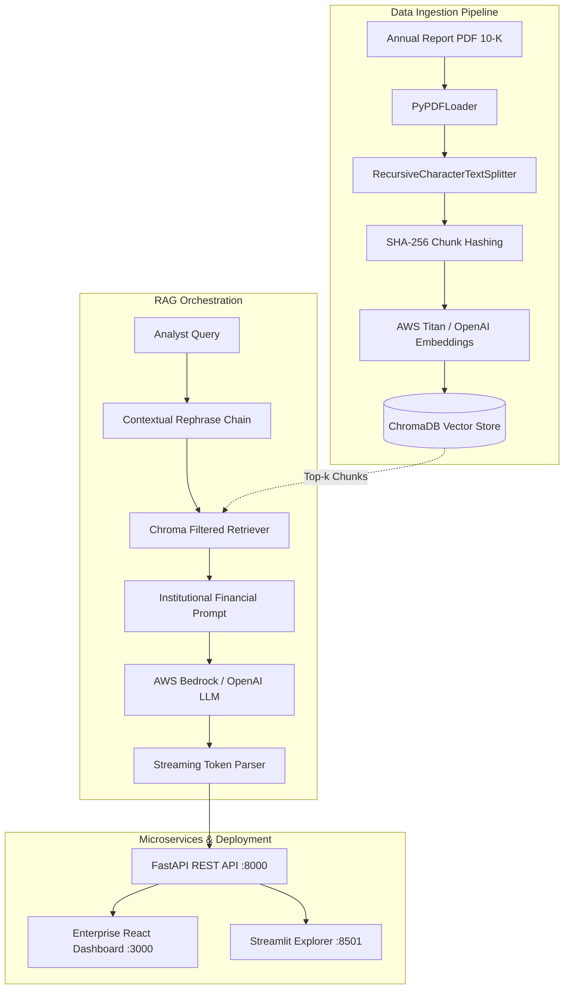

# 📈 AI-Powered Financial Stock Analysis

[](https://www.python.org/)
[](https://fastapi.tiangolo.com)
[](https://react.dev/)
[](https://streamlit.io)
[](https://www.langchain.com/)
[](https://aws.amazon.com/bedrock/)
[](https://www.docker.com/)
[](https://github.com/Himansh19-lab/AI-powered-stock-analysis/actions)
[](LICENSE)

An enterprise-grade **Retrieval-Augmented Generation (RAG)** intelligence platform built to parse, index, and analyze corporate annual reports (SEC 10-K, 10-Q) with institutional financial rigor. The system automates structured equity research dossiers and provides an interactive conversational analyst with real-time token streaming and citation attribution.

---

## 🌟 Key Features

- **📊 Bloomberg-Style Enterprise React Dashboard**: Dark slate institutional UI built with React 18, Vite, Lucide icons, and responsive Nginx reverse proxy.
- **📑 Institutional Financial Dossier Generation**: Synthesizes structured investment reports covering Consolidated Statements of Operations, revenue segments, operational risks, and valuation drivers.
- **💬 Conversational RAG with Contextual Rephrasing**: Multi-turn dialogue with memory that reformulates follow-up queries based on conversational history.
- **⚡ Real-Time Streaming Responses**: Low-latency token streaming using Server-Sent Events (`text/event-stream`) in FastAPI.
- **📥 Smart PDF Ingestion & Batch Indexing**: Upload corporate 10-K PDFs with deterministic SHA-256 chunk hashing and batched ChromaDB insertions (500 chunks/batch) to avoid SQLite batch limits.
- **🎯 Document-Filtered Retrieval**: Switch between global portfolio search or isolate retrieval strictly to a selected filing (e.g., `NASDAQ_AAPL_2025.pdf`).
- **☁️ Multi-Cloud & Hybrid Inference**: Support for **AWS Bedrock** (`amazon.titan-embed-text-v2:0`, `amazon.nova-pro-v1:0`, `meta.llama3-1-70b-instruct-v1:0`) and fallback to **OpenAI** (`gpt-4o-mini`).
- **🚀 Automated CI/CD & EC2 Deployment**: Fully automated testing with `pytest`, GHCR Docker image publishing, and SSH-based Continuous Deployment to AWS EC2 (`c7i-flex.large`).

---

## 🏗️ Architecture



---

## 📂 Project Structure

```text
AI-powered-stock-analysis/
├── config/
│   └── config.yaml               # Centralized configuration (models, chunk sizes, paths)
├── data/                         # Uploaded company annual reports (.pdf)
├── frontend-react/               # Enterprise React 18 + Vite frontend
│   ├── src/
│   │   ├── App.jsx               # Bloomberg-style institutional dashboard
│   │   └── index.css             # Dark slate design system & tokens
│   ├── Dockerfile                # Multi-stage production Nginx build
│   └── package.json
├── storage/                      # Persistent ChromaDB vector database
├── logs/                         # Structured application logs
├── src/
│   ├── backend/
│   │   ├── api/
│   │   │   ├── route.py          # FastAPI endpoints (/health, /upload, /report, /chat, /companies)
│   │   │   └── schema.py         # Pydantic v2 validation models
│   │   ├── generation/
│   │   │   ├── llm.py            # AWS Bedrock Converse & OpenAI LLM Factory
│   │   │   └── prompt.py         # Institutional financial prompt templates
│   │   ├── indexing/
│   │   │   ├── document_loader.py# PyPDFLoader with metadata extraction
│   │   │   ├── document_split.py # Recursive text chunker (1000 chunk size, 200 overlap)
│   │   │   └── vector_store.py   # ChromaDB manager with batching & deduplication
│   │   ├── pipeline/
│   │   │   └── rag_pipeline.py   # End-to-end Financial RAG pipeline orchestrator
│   │   ├── retriever/
│   │   │   └── retriever.py      # Filtered similarity retriever with k=5
│   │   └── utils/
│   │       ├── config.py         # Pydantic YAML config loader
│   │       └── logger.py         # Standardized logging utility
│   └── frontend/
│       └── app.py                # Streamlit secondary interface
├── tests/                        # Automated Pytest suite (API, indexing, schemas)
├── .github/workflows/
│   ├── ci.yml                    # Automated unit tests on pull requests & pushes
│   └── cd.yml                    # Docker build, GHCR push, & automated EC2 deploy
├── Dockerfile                    # Backend & Streamlit multi-purpose container
├── docker-compose.yml            # Multi-container orchestration (FastAPI + React + Streamlit)
├── pyproject.toml                # Project dependencies (managed via uv)
└── README.md
```

---

## 🚀 Quickstart: Docker Compose (Recommended)

The easiest way to run the full stack (FastAPI Backend + Enterprise React UI + Streamlit) is with Docker Compose:

### 1. Clone & Configure
```bash
git clone https://github.com/Himansh19-lab/AI-powered-stock-analysis.git
cd AI-powered-stock-analysis
cp .env.example .env
```
Fill in your credentials inside `.env`:
```env
OPENAI_API_KEY=your_openai_api_key
AWS_ACCESS_KEY_ID=your_aws_access_key
AWS_SECRET_ACCESS_KEY=your_aws_secret_key
AWS_DEFAULT_REGION=us-east-1
```

### 2. Launch Containers
```bash
docker compose up -d --build
```

### 3. Access the Services
| Service | URL | Description |
| :--- | :--- | :--- |
| **Enterprise React UI** | `http://localhost:3000` | Bloomberg-style financial dashboard |
| **FastAPI Swagger Docs**| `http://localhost:8000/docs` | Interactive REST API documentation |
| **Streamlit Explorer**  | `http://localhost:8501` | Alternative lightweight UI |

### 4. Stop Containers
```bash
docker compose down
```

---

## 💻 Local Development Setup

### Prerequisites
- Python `3.12+`
- Node.js `20+` & npm
- [uv](https://docs.astral.sh/uv/) (Astral package manager)

### 1. Install Backend Dependencies
```bash
uv sync
```

### 2. Start Backend API
```bash
uv run uvicorn --app-dir src backend.api.route:app --reload --port 8000
```

### 3. Start React Frontend
```bash
cd frontend-react
npm install
npm run dev
```

### 4. Run Test Suite
```bash
uv run pytest -v
```

---

## 📡 API Endpoints

| Method | Endpoint | Description |
| :--- | :--- | :--- |
| **GET** | `/api/v1/health` | Service health check |
| **POST** | `/api/v1/upload` | Upload & index corporate annual report PDF |
| **GET** | `/api/v1/companies` | List all indexed SEC filing PDFs |
| **POST** | `/api/v1/report` | Generate structured institutional financial report |
| **POST** | `/api/v1/chat` | Conversational RAG assistant (supports token streaming) |

---

## ☁️ Production Deployment (AWS EC2)

This repository includes a continuous deployment workflow via GitHub Actions:

1. **EC2 Provisioning**: Ubuntu Server 24.04 LTS on `c7i-flex.large` (2 vCPUs, 4 GB RAM, x86_64).
2. **Security Groups**: Open inbound ports `22` (SSH), `3000` (React), `8000` (FastAPI), and `8501` (Streamlit).
3. **Automated CI/CD**: Pushing to the `main` branch automatically runs tests, builds container images, and deploys directly to EC2 via GitHub Actions secrets (`EC2_HOST`, `EC2_USER`, `EC2_SSH_KEY`).

---

## 📄 License

This project is licensed under the [MIT License](LICENSE).

---

## 👤 Author

**Himanshu Srivastava**  
- GitHub: [@Himansh19-lab](https://github.com/Himansh19-lab)
